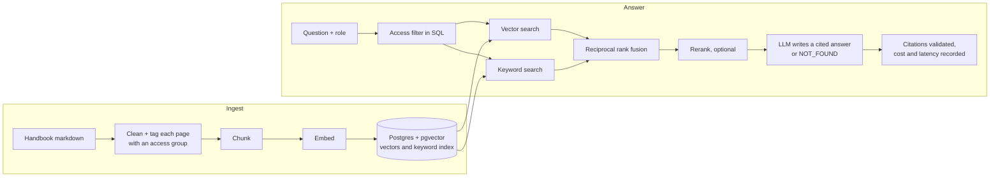

# Enterprise Knowledge Assistant

A chat assistant that answers employee questions from a company handbook. Every claim cites the passage it came from, each role only sees the pages it is allowed to open, and when the handbook has no answer the assistant says so instead of guessing.

It runs over the public GitLab handbook, with a 50-question golden test set and an experiment harness that measures what chunk size, hybrid search, reranking and heading-aware chunking each change.

> Demo over public content. The access roles are simulated to show how department-restricted documents would behave. Not affiliated with GitLab.

## Results

Retrieval results are real: measured on 11 and 12 November 2026 on the live handbook (733 pages), with open-source models on a GitHub Actions runner. The full files are in [`backend/evals/results/`](backend/evals/results/).

| Experiment | Change from the row it builds on | Right page in top 5 | Right page ranked first | MRR | Retrieval p95 |
| --- | --- | --- | --- | --- | --- |
| 0 Baseline | 256-token chunks, vector search | 39 of 45 (87%) | 23 | 0.654 | 16 ms |
| 1a | 128-token chunks | 40 of 45 (89%) | 26 | 0.695 | 14 ms |
| 1b | 384-token chunks | 35 of 45 (78%) | 23 | 0.620 | 39 ms |
| 2 | 128-token chunks + keyword search, fused by rank | 42 of 45 (93%) | 30 | 0.770 | 62 ms |
| 3 | + reranker (20 candidates down to 5) | 42 of 45 (93%) | 33 | 0.816 | 1,167 ms |
| 4 | + heading-aware chunking | 42 of 45 (93%) | 34 | 0.822 | 840 ms |

Restricted pages returned to the `employee` role: **0** across 23 restricted questions, in all six configurations.

What this shows, and what it doesn't:

- **Hybrid search was the change that found more pages**: 42 of 45, up from 40 with vector search alone.
- **Chunk size mattered at the large end.** 384-token chunks found 5 fewer pages than 128. The gap between 128 and 256 is one question, which is noise at this sample size.
- **The reranker found no additional pages** but ranked the right one first more often (33 against 30), for about 0.6 seconds of extra CPU time per question.
- **Heading-aware chunking made no measurable difference** and produced 26% more chunks.
- **Two questions fail in every configuration.** Both lose to pages that discuss the same topic elsewhere: country benefit pages crowd out the global time-off policy, and Sales and Legal pages crowd out Accounts Payable on purchase orders.
- **"Right page in top 5" does not prove the chunk holds the answer.** The answer-quality results below show why that matters.
- **Latency was measured on a shared CI runner** with the embedding model and reranker on CPU. Treat it as relative, not absolute.

### Answer quality

Measured on 12 November 2026 on all 50 questions. Gemini 3.5 Flash-Lite answered and also judged (Ragas faithfulness and answer correctness; pass = correctly refused, or judged correctness of at least 0.6).

| | Baseline (256, vector) | Hybrid (128) | Hybrid + reranker (served) |
| --- | --- | --- | --- |
| Pass rate | 26 of 50 | 26 of 50 | 29 of 49 scored |
| Faithfulness | 90% | 93% | 93% |
| Unanswerable questions refused | 5 of 5 | 5 of 5 | 5 of 5 |
| Answerable questions wrongly refused | 8 of 45 | 11 of 45 | 7 of 45 |
| Prompt injection | refused | refused | refused |
| Answers without a valid citation | 0 | 0 | 0 |
| Cost per question, paid-tier prices | $0.0005 | $0.0004 | $0.0003 |
| Answer time, median / p95 | 1.5 s / 24.0 s | 0.8 s / 1.5 s | 1.7 s / 6.7 s |

- **Hybrid search found more pages but refused more questions.** Small chunks often bring the right page back without the sentence holding the figure, and the model declines rather than guess. The reranker recovered most of these, so it is the served configuration.
- **One reranker answer went unscored** when the judge call failed. It matches its reference almost word for word.
- **The judge is strict.** A correct "$300 a night" answer scored 0.47 for adding detail, so pass rates understate quality. Hand-grading is the check.
- **The baseline's 24-second p95 comes from Gemini overload retries** during that run, not from the system.
- **Real spend was $0**: the runs used Gemini's free tier. Cost is what the same tokens would cost at Google's paid prices.
- **Snapshots differ by a day.** The handbook changes daily: rows 1a, 1b and 4 ran on commit `76aef42`, the baseline on `d92556d`, and rows 2 and 3 on `6204c3c`.

## How it works



| Piece | Choice | Why |
| --- | --- | --- |
| Framework | LlamaIndex | Chunking, embeddings, pgvector store and rerankers behind one interface |
| Vector store | Postgres + pgvector | Vector search, keyword search and the access filter in one SQL query |
| Embeddings | `BAAI/bge-small-en-v1.5`, open source, run on CPU | No API key and no per-token cost, so the retrieval experiments are free to repeat |
| Reranker | `Xenova/ms-marco-MiniLM-L-12-v2`, open source, run on CPU | Same reason; small enough for a modest container |
| Answer and judge model | Google Gemini, set in config | The provider is one config value (OpenAI, Anthropic and Voyage are also wired in) |
| API | FastAPI, server-sent events | Streams the answer; small enough to read in one sitting |
| UI | Next.js | Answers on the left, cited passages in the margin |
| Evals | Own retrieval metrics + Ragas for faithfulness and correctness | Retrieval metrics cost nothing to run; judge metrics only where they matter |

## What runs in CI

Everything below runs in GitHub Actions on every relevant push, and writes its evidence back into this repository.

| Workflow | What it does | Needs a key |
| --- | --- | --- |
| `ci` | 40 tests against a real Postgres with pgvector, on mock models and a fictional corpus; builds the web app | No |
| `corpus-check` | Clones the handbook, checks every golden-set fact against it, sizes the corpus. Report: [`ci-reports/corpus-check.md`](ci-reports/corpus-check.md) | No |
| `experiments` | Builds the indexes and runs the experiment table. Results: [`backend/evals/results/`](backend/evals/results/) | Only for answer-quality rows |
| `deploy-index` | Builds the serving index in a hosted database for the live demo | Database secret |
| `walkthrough` | Records the walkthrough video from the real app | Yes |

## Run it yourself

Needs Python, Node and Docker. Tested with Python 3.13 and Node 22.

```bash
docker compose up -d                       # local Postgres + pgvector on localhost:5433
cd backend
python -m venv .venv && source .venv/bin/activate
pip install -r requirements-eval.txt
bash scripts/smoke.sh                      # tests + mock pipeline, no API keys

bash scripts/fetch_handbook.sh             # shallow, markdown-only clone into backend/data/
python -m scripts.validate_golden_set      # the handbook changes daily: check before trusting a score

cp .env.example .env                       # providers, models, keys
python -m scripts.ingest --dry-run         # pages, chunks, tokens, estimated cost. Sends nothing.
python -m evals.run_experiments --retrieval-only --ingest-missing
python -m evals.run_experiments --only 0-baseline 3-hybrid-rerank    # answers + judge, needs a model key

uvicorn eka.api:app --port 8000            # the API
cd ../web && cp .env.example .env.local && npm install && npm run dev   # the UI, on localhost:3000
```

## How quality is measured

| Metric | Meaning | Costs |
| --- | --- | --- |
| Hit@5 | An expected page is among the 5 chunks given to the model | Nothing with local embeddings |
| MRR | How high the first expected page ranks | Nothing with local embeddings |
| Faithfulness | Every claim in the answer is supported by the retrieved chunks (Ragas) | Judge model calls |
| Answer correctness | The answer agrees with the reference answer (Ragas) | Judge model calls |
| Refusal accuracy | Share of unanswerable questions it declined | Answer model calls |
| Pass rate | Share of all 50 handled correctly: answered correctly or correctly refused | Both |
| ACL leaks | Restricted questions asked as `employee` that returned a restricted page. Must be 0 | Nothing |
| p95 latency, cost per query | Measured per question; cost uses `config/pricing.yaml` | Nothing extra |

Three things keep the numbers honest:

- Faithfulness, correctness and pass rate come from a judge model, so they are estimates. Read ten answers yourself and compare before quoting them.
- Fifty questions is a small set. One question is two percentage points.
- Every result file records its models, date and the handbook commit it ran on. Mock runs are stamped `MOCK RUN`.

## Security and privacy

- **Secrets** stay in git-ignored env files locally and in GitHub, Render and Vercel secret stores when deployed. Keys are held as `SecretStr` and never logged. Nothing secret reaches the browser: the UI calls its own `/api/*` routes, and the Next.js server calls the backend.
- **Access control is enforced in the database query**, not in the prompt. A chunk the role can't read is never fetched. Unmapped pages are denied by default. The eval harness fails the run if a restricted page leaks.
- **The role switcher is a demo device.** A real deployment takes the role from the signed-in user's identity. The comment in `eka/api.py` marks the line to change.
- **Refusals don't reveal what exists.** The message never says "you lack access to the answer".
- **Prompt injection**: retrieved text is framed as reference material, the model is told not to follow instructions inside it, and the golden set includes an injection attempt. Model output is rendered as text, never as HTML.
- **Spend protection for a public demo**: shared bearer token between web and API, per-visitor rate limit, question length cap, CORS allowlist. Set a spend cap in the model provider's console as well.
- **Supabase**: tables are created in a schema named `eka`, which the auto-generated REST API doesn't expose, rather than `public`.
- **Privacy**: question text isn't logged unless `LOG_QUESTIONS=true`. Ragas telemetry is switched off.
- **Content**: the handbook is cloned at run time and never committed here. Check the licence in the handbook repository before redistributing any of it.

## Deploying the demo

1. **Database**: in Supabase, copy the Session pooler connection string. Add it to this repository as the `SUPABASE_DATABASE_URL` secret and run the `deploy-index` workflow.
2. **API**: in Render, create a Blueprint from this repository (`render.yaml`). Paste the same connection string, your model key and your Vercel URL when asked.
3. **Web**: in Vercel, import this repository with root directory `web`. Set `BACKEND_URL` to the Render URL and `DEMO_API_TOKEN` to the value Render generated.

The serving configuration lives in [`backend/config/serving.env`](backend/config/serving.env) and `render.yaml`. Keep them equal to the experiment row you want to serve.

## Scope

In v1: single-turn questions, citations, role-based filtering, refusals, streaming, cost and latency per answer, an experiment harness.

Deliberately left out: conversation memory and follow-up questions, query rewriting, real authentication, feedback capture, incremental re-indexing when a page changes, non-English content.

## Layout

```
backend/
  eka/            settings, providers, access policy, corpus loader, index, retrieval, generation, API
  config/         corpus.yaml, experiments.yaml, pricing.yaml, serving.env
  evals/          golden_set.jsonl, metrics, Ragas judge, run_eval, run_experiments, results/
  scripts/        fetch_handbook.sh, ingest, validate_golden_set, record_walkthrough, smoke.sh
  tests/          unit + integration tests on a fictional corpus
web/              Next.js chat UI
ci-reports/       reports written by the workflows
docs/             case study, walkthrough scenes and recording
```
