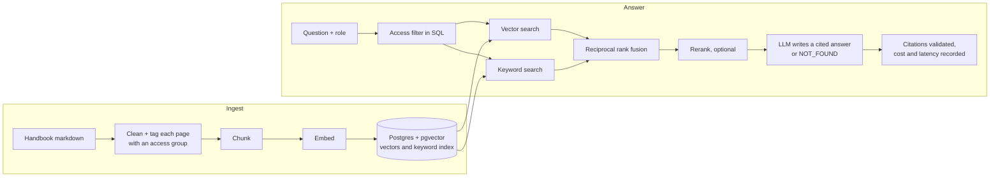

# Enterprise Knowledge Assistant

A chat assistant that answers employee questions from a company handbook. Every claim cites the passage it came from, each role only sees the pages it is allowed to open, and when the handbook has no answer the assistant says so instead of guessing.

It runs over the public GitLab handbook, and ships with a 50-question golden test set and an experiment harness that measures what chunk size, hybrid search, reranking and heading-aware chunking each change.

> Demo over public content. The access roles are simulated to show how department-restricted documents would behave. Not affiliated with GitLab.

## How it works



| Piece | Choice | Why |
| --- | --- | --- |
| Framework | LlamaIndex | Chunking, embeddings, pgvector store and rerankers behind one interface |
| Vector store | Postgres + pgvector (Supabase or local Docker) | Vector search, keyword search and the access filter in one SQL query |
| Models | Set in `.env`: OpenAI, Anthropic, Gemini, Voyage, Cohere | Provider is a config change, so the cheapest model that passes the evals wins |
| API | FastAPI, server-sent events | Streams the answer; small enough to read in one sitting |
| UI | Next.js | Answers on the left, cited passages in the margin |
| Evals | Own retrieval metrics + Ragas for faithfulness and correctness | Retrieval metrics are free to run; judge metrics only on finalists |

## What has and hasn't been verified

Checked while building (2026-11-11), all on mock models and a fictional five-page corpus:

- 33 automated tests pass, including integration tests against a real Postgres with pgvector: ingestion, vector and hybrid search, role filtering, the API stream, rate limiting.
- A clean install from `requirements.txt` works, and `scripts/smoke.sh` runs end to end.
- The web app builds, and was clicked through in a browser against the API.
- The Ragas scoring path returns numbers when given a scripted judge.

Not yet run, because it needs your keys and network access:

- Cloning the handbook. `fetch_handbook.sh` assumes the repository is `gitlab-com/content-sites/handbook` with pages under `content/handbook/`. If the clone or `validate_golden_set` fails, that assumption is the first thing to check.
- Any call to a real model, embedding or rerank API, and Ragas with a real judge.
- The Supabase connection, the local reranker and the Dockerfile.
- The prices in `config/pricing.yaml`. They came from third-party trackers.

There are no results in this repository yet. Every number in the case study has to come from your own runs.

## Run it

Needs Python, Node and Docker (or a Supabase project). Tested with Python 3.13 and Node 22.

### 1. Check the install, for free

```bash
docker compose up -d                       # local Postgres + pgvector on localhost:5433
cd backend
python -m venv .venv && source .venv/bin/activate
pip install -r requirements.txt
bash scripts/smoke.sh                      # tests + mock pipeline, no API keys
```

### 2. Get the corpus and check the golden set against it

```bash
bash scripts/fetch_handbook.sh             # shallow, markdown-only clone into backend/data/
python -m scripts.validate_golden_set
```

The golden set was written from the live handbook site on 2026-11-11. The handbook changes daily, so this script checks that every source page exists in your clone and still contains the facts each reference answer depends on. Fix or replace any question it flags before you trust a score. The five unanswerable questions can't be checked automatically: read them and confirm the handbook really doesn't answer them.

### 3. Configure

```bash
cp .env.example .env                       # then fill in providers, models and keys
```

Fill in `config/pricing.yaml` for the models you chose, from the providers' own pricing pages.

### 4. Build the index

```bash
python -m scripts.ingest --dry-run         # pages, chunks, estimated tokens and cost. Sends nothing.
python -m scripts.ingest
```

### 5. Run the experiments

```bash
python -m evals.run_experiments --retrieval-only --ingest-missing   # cheap pass: pick a chunk size
python -m evals.run_experiments                                     # full pass: the table you publish
```

The plan is in `config/experiments.yaml`. Results land in `backend/evals/results/`, with `experiments.md` ready to paste into the case study. Each result records the models, the date and the handbook commit it ran on.

Then copy the winning row's settings into `.env`, so the demo serves the configuration you measured.

### 6. Run the app

```bash
uvicorn eka.api:app --port 8000            # in backend/
cp .env.example .env.local && npm install && npm run dev   # in web/, then open localhost:3000
```

## How quality is measured

| Metric | Meaning | Costs |
| --- | --- | --- |
| Hit@k | An expected page is among the k chunks given to the model | Query embeddings only |
| MRR | How high the first expected page ranks | Query embeddings only |
| Faithfulness | Every claim in the answer is supported by the retrieved chunks (Ragas) | Judge model calls |
| Answer correctness | The answer agrees with the reference answer (Ragas) | Judge model calls |
| Refusal accuracy | Share of unanswerable questions it declined | Answer model calls |
| False refusal rate | Share of answerable questions it wrongly declined | Answer model calls |
| Pass rate | Share of all 50 handled correctly: answered correctly or correctly refused | Both |
| ACL leaks | Restricted questions asked as `employee` that returned a restricted page. Must be 0 | Query embeddings only |
| p50 / p95 latency, cost per query | Measured per question; cost uses `config/pricing.yaml` | None |

Three things to keep the numbers honest:

- Faithfulness, correctness and pass rate come from a judge model, so they are estimates. Read at least ten answers yourself, compare with the scores, and adjust `--pass-threshold` (default 0.6) if the judge is stricter or looser than you.
- Fifty questions is a small set. A two-point difference between experiments is one question. Report counts alongside percentages.
- Label every figure in the write-up as real (measured on this golden set, date, models). Mock runs are stamped `MOCK RUN` and must never be quoted.

## Security and privacy

- **Secrets** stay in `backend/.env` and `web/.env.local`, both git-ignored. Keys are held as `SecretStr` and never logged. Nothing secret is exposed to the browser: the UI calls its own `/api/*` routes, and the Next.js server calls the backend.
- **Access control is enforced in the database query**, not in the prompt. A chunk the role can't read is never fetched. Unmapped pages are denied by default. The eval harness fails the run if a restricted page leaks.
- **The role switcher is a demo device.** A real deployment takes the role from the signed-in user's identity. The comment in `eka/api.py` marks the line to change.
- **Refusals don't reveal what exists.** The message never says "you lack access to the answer".
- **Prompt injection**: retrieved text is framed as reference material, the model is told not to follow instructions inside it, and the golden set includes an injection attempt. Model output is rendered as text, never as HTML.
- **Spend protection for a public demo**: shared bearer token between web and API (`DEMO_API_TOKEN`), per-visitor rate limit, question length cap, CORS allowlist. Set a monthly spend limit in each provider's console as well.
- **Supabase**: tables are created in a schema named `eka`, which the auto-generated REST API doesn't expose, rather than `public`. Use the session pooler connection string (port 5432).
- **Privacy**: question text isn't logged unless `LOG_QUESTIONS=true`. Ragas telemetry is switched off in `evals/judges.py`.
- **Content**: the handbook is cloned to `backend/data/`, which is git-ignored. Check the licence in the handbook repository before redistributing any of it.

## Scope

In v1: single-turn questions, citations, role-based filtering, refusals, streaming, cost and latency per answer, an experiment harness.

Deliberately left out: conversation memory and follow-up questions, query rewriting, real authentication, feedback capture, incremental re-indexing when a page changes, tables and images in pages, non-English content.

## Layout

```
backend/
  eka/            settings, providers, access policy, corpus loader, index, retrieval, generation, API
  config/         corpus.yaml (what's indexed, who can read it), experiments.yaml, pricing.yaml
  evals/          golden_set.jsonl, metrics, Ragas judge, run_eval, run_experiments
  scripts/        fetch_handbook.sh, ingest, validate_golden_set, smoke.sh
  tests/          unit + integration tests on a fictional corpus
web/              Next.js chat UI
docs/             case-study.md (write-up skeleton)
```
